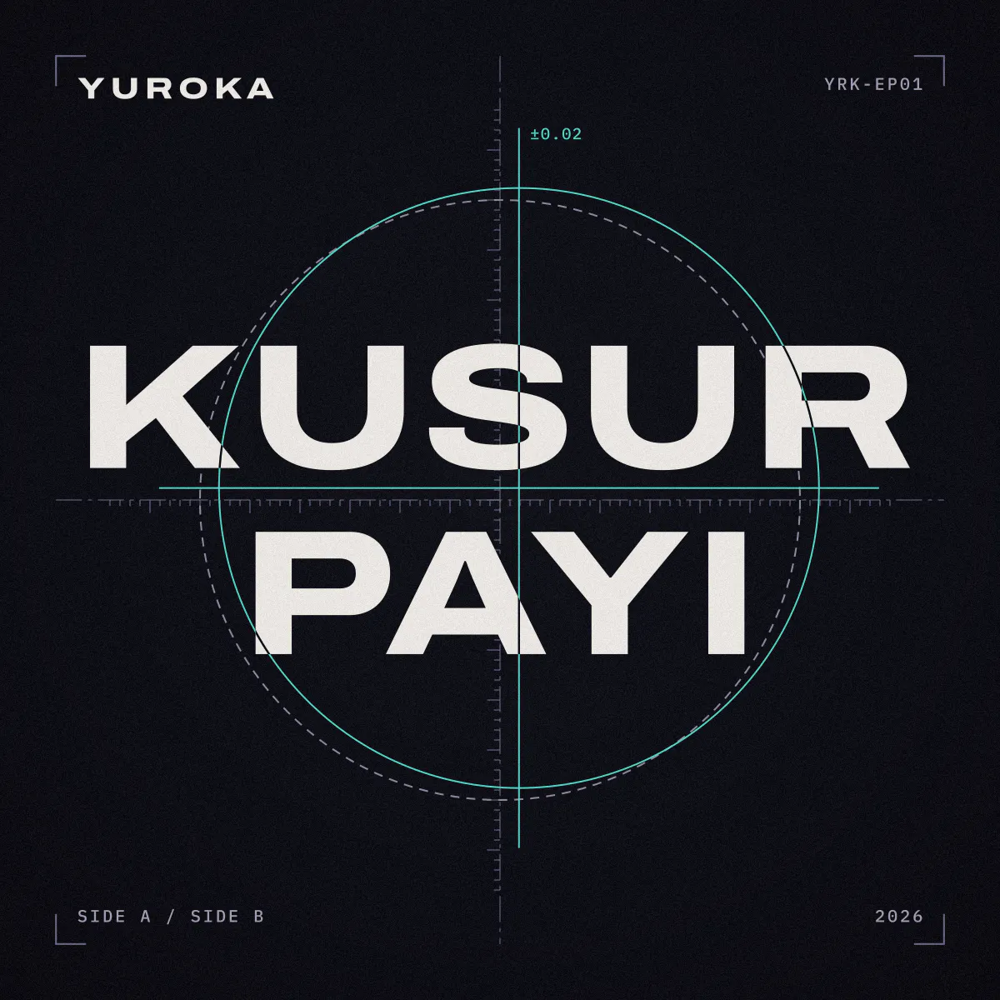
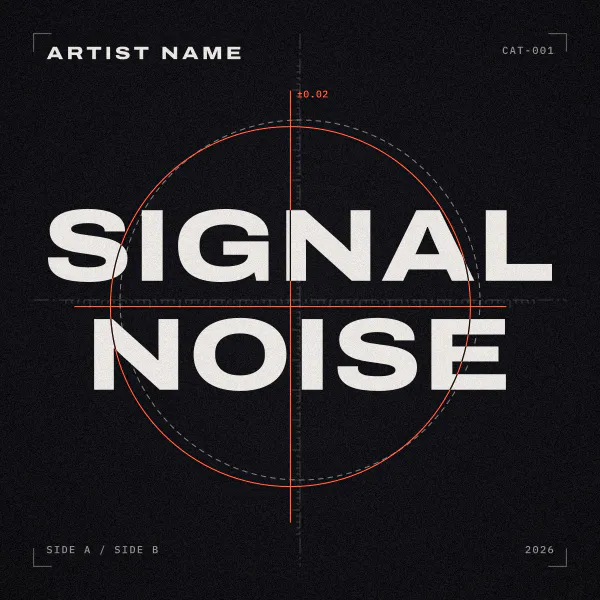
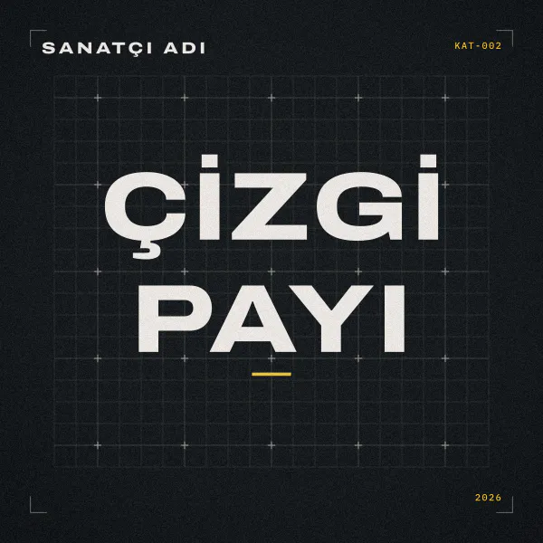

# type-cover

Deterministic, code-generated **typographic cover art** for releases. No AI imagery, no stock photos, no network: a title, a few labels and one accent colour, drawn as vectors, finished with seeded film grain, and written out as a 3000 px master plus web sizes. The same settings give the **same bytes** every time.

<p align="center"></p>

It started as the generator for the KUSUR PAYI EP cover by Yuroka (the picture above) and was generalised into a small tool.

- **Crosshair template:** drawn like a technical drawing. The title sits on dash-dot centre lines with a ruler, a dashed circle marks where the registration mark *should* be, and the real mark in the accent colour is off by a small, measured amount, like a misregistered print plate. Where the accent lines cross the letters they are cut out of them. The offset is the "error", with a label such as `±0.02`.
- **Grid template:** a plain graph-paper grid, no crosshair.
- **Text that fits.** The title (1 or 2 lines) is auto-fitted, and every label is measured from its real outline, so letters with dots, cedillas or descenders never run into the ruler, the corner marks or each other.
- **Fully offline.** Fonts are bundled, nothing is fetched at runtime, no telemetry, no paid services. MIT licensed; the fonts are SIL OFL.

| crosshair, any colours | grid template |
| --- | --- |
|  |  |

## Quick start

Needs Node 20.9 or newer.

```sh
git clone https://github.com/yuroka-studio/type-cover
cd type-cover
npm install
node bin/type-cover.js --config examples/kusur-payi.json --out out/showcase      # the showcase
node bin/type-cover.js --title "SIGNAL|NOISE" --artist "ARTIST NAME" --catalog CAT-001 \
  --year 2026 --footer-left "SIDE A / SIDE B" --accent "#FF6B4A" --out out
```

Each command writes `cover-3000.jpg` (the master), `cover-1200.{jpg,webp,avif}` and `cover-600.{jpg,webp,avif}` into its `--out` folder (`out/showcase` and `out` here, so the second does not overwrite the first); add `--svg` for `cover.svg`. A file that is already there is replaced. `npm link` gives you a `type-cover` command.

## Settings

Everything can be a flag or a key in a JSON file (`--config cover.json`). Flags win over the file. Unknown keys and wrong types are errors, so a typo cannot silently do nothing: `uppercase` and `svg` must be `true` or `false` (not `"false"` or `"no"`), and `formats` needs at least one entry when a size below 2000 is asked for. Keys that start with `_` or `$` in the file are ignored, handy for notes. See [`examples/`](examples).

| flag | config key | default | |
| --- | --- | --- | --- |
| `--title` | `title` | required | 1 or 2 lines. `"A\|B"` or a real newline force the break, and in a JSON config so do `"A\nB"` and `["A", "B"]`; otherwise it is chosen for you. On the command line a typed `\n` is **not** a break: use `"A\|B"` or, in bash and zsh, `$'A\nB'` |
| `--title-lines` | `titleLines` | `auto` | `1`, `2`, or `auto`: two lines only if the type can be at least 20% larger that way |
| `--artist` | `artist` | none | top left, set as a small wide wordmark |
| `--catalog` | `catalog` | none | top right |
| `--footer-left` | `footerLeft` | none | bottom left |
| `--year` | `year` | none | bottom right. There is no default: the tool never reads the clock |
| `--accent` | `accent` | `#5FD0C4` | the one accent colour |
| `--background` | `background` | `#080810` | a soft vignette is derived from it |
| `--ink` | `ink` | from the background | text colour |
| | `colors` | derived | optional `{ "rule", "muted", "guide" }` hex overrides for the lines and small text |
| `--grain` | `grain` | `0.07` | 0 to 1; 0 turns it off |
| `--seed` | `seed` | `1` | whole number; another seed is another (equally fine) grain |
| `--error` | `error` | `19,-12` | the off-centre offset `x,y`, in artboard units (1000 = the whole cover) |
| `--error-label` | `errorLabel` | `±` + length / 1000 | label at the end of the cross, e.g. `±0.02`; `""` removes it |
| `--template` | `template` | `crosshair` | or `grid` |
| `--uppercase` | `uppercase` | off | upper-case all text with the language rules of `--locale` |
| `--locale` | `locale` | `en` | `tr` makes `i` become `İ` (and `ı` become `I`) |
| `--title-weight` | `titleWeight` | `800` | Archivo weight, 100 to 900 |
| `--title-width` | `titleWidth` | `125` | Archivo width, 62 (narrow) to 125 (expanded). Narrower fits long titles bigger |
| `--out` | | `out` | output folder |
| `--name` | `name` | `cover` | file name base |
| `--sizes` | `sizes` | `3000,1200,600` | any whole numbers 64 to 8000 |
| `--formats` | `formats` | `jpg,webp,avif` | for the sizes below 2000; 2000 and up is always a JPG |
| `--svg` | `svg` | off | also write the vector master |

Negative numbers after a flag need an `=`: `--error=-16,11` (a bare `--error -16,11` is read as another flag and refused). Each title line and each label may be up to 100 characters, and the title up to 40 words; anything longer is refused with a message (nothing that long can be set legibly on the cover).

**Text is drawn exactly as you type it.** Nothing is upper-cased for you: JavaScript would turn `isimsiz` into `ISIMSIZ` (wrong for Turkish) and `ß` into `SS`. Use `--uppercase --locale tr` when you want capitals.

### Languages

The bundled fonts cover Latin and Latin Extended: Turkish (`İ ı Ş ş Ğ ğ Ç ç Ö Ü`), German (`ä ö ü ß`), French (`é è ê ë à â ç î ï ô û ù œ`), Polish, Czech and more, plus Vietnamese for the display font. Greek, Cyrillic, Arabic and CJK are **not** covered by the display font, and the tool refuses them with a message instead of drawing empty boxes. The tests render `KUSUR PAYI`, `İSİMSİZ` and `Fehlertoleranz`.

## How the layout stays clean

All text is turned into vector outlines from the bundled fonts and measured: the real outline bounds, not font metrics.

- **Title.** The largest size up to 178 units at which the widest line is at most 840 units wide (the cover is 1000 units). With `auto`, one or two lines is whichever allows larger type; two lines break at the best word boundary. Type below 36 units is refused with advice (shorten it, break it, or lower `titleWidth`).
- **The scale.** Title ink keeps 32 units from the centre line. A cedilla (`Ş`, `Ç`) on the first line pushes that line up, and dots or breves (`İ`, `Ğ`) on the second push it down, so nothing touches the ruler.
- **Corner labels.** Each of the four corner labels owns half of its row, clear of the vertical centre line. A label that is too wide shrinks (down to 55% of its size, with a warning), then is refused. Rows move away from the bracket when a name carries diacritics or descenders.
- **The cross.** Its arms and the error label stay clear of the label rows and corner marks. An `error` too large for that is limited, with a warning.

The tests check this geometry for a battery of titles, label sets and offsets (no text outside the frame, no two texts overlapping, nothing touching a corner mark or the centre line).

## Outputs

| file | size | format |
| --- | --- | --- |
| `cover-3000.jpg` | 3000 x 3000 | JPG, quality 90, 4:4:4 (streaming services ask for 3000 px or more) |
| `cover-1200.jpg` `.webp` `.avif` | 1200 x 1200 | web and social |
| `cover-600.jpg` `.webp` `.avif` | 600 x 600 | thumbnails |
| `cover.svg` (with `--svg`) | 3000 x 3000 | the vector master, no grain (grain is a raster effect) |

All images are plain sRGB with no alpha and no metadata (no timestamps, no EXIF).

## Determinism

The same settings and the same installed `sharp` give byte-identical files, run after run: fonts come from the package, not the system; the grain comes from a seeded generator; no clock, no random number, no file metadata. A test renders everything twice (JPG, WebP, AVIF, SVG) and compares bytes, once in one process and once across processes.

Pixels are identical in intent everywhere, but the image *encoders* inside `sharp` can differ slightly between versions of `sharp` and between CPU architectures (x64 and arm64), so there are no committed hashes: compare files made on the same machine and install.

## Library

```js
import { renderCover, writeCover, renderSvg } from "type-cover";

const { files, warnings } = await renderCover({
  title: "KUSUR PAYI", artist: "YUROKA", catalog: "YRK-EP01", year: "2026",
  accent: "#5FD0C4", error: [19, -12], sizes: [1200], formats: ["webp"],
});
// files: [{ name: "cover-1200.webp", size: 1200, format: "webp", data: Buffer }]

await writeCover({ title: "İSİMSİZ" }, "out");     // renders and writes into a folder
const svg = renderSvg({ title: "Fehlertoleranz" }); // the vector master as a string
```

## Fonts

Bundled in [`fonts/`](fonts), each with its licence file. Both are under the SIL Open Font License 1.1, which allows bundling and use in artwork.

| font | use | licence |
| --- | --- | --- |
| **Archivo** (variable, weight and width axes), from the Google Fonts release | title and artist wordmark | [`fonts/Archivo/OFL.txt`](fonts/Archivo/OFL.txt), Copyright 2020 The Archivo Project Authors |
| **IBM Plex Mono** Medium, from the Google Fonts release | labels | [`fonts/IBMPlexMono/OFL.txt`](fonts/IBMPlexMono/OFL.txt), Copyright 2017 IBM Corp. with Reserved Font Name "Plex" |

The fonts are used unmodified. Because the type is converted to outlines, the images and the SVG contain no font software.

## Tests

```sh
npm install
npm test     # node --test, Node 20, 22 and 24 in CI (ubuntu)
```

Covers determinism, the three sample titles, glyph coverage, auto-fit, collision geometry, config validation, the command line and every example.

## Not included

- No other templates beyond the crosshair and the grid, and no custom fonts yet.
- No raster input of any kind: no photos, no AI.
- No ICC profile embedding or CMYK output (covers are sRGB, which is what streaming services expect).

## License

MIT, © Yuroka Studio, see [LICENSE](LICENSE). The bundled fonts keep their own licences (SIL OFL 1.1).

---

## Türkçe

**type-cover**, yayınlar için **koddan üretilen tipografik kapak görselleri** hazırlar: yapay zekâ görseli yok, stok fotoğraf yok, ağ bağlantısı yok. Başlık, birkaç etiket ve tek bir vurgu rengi vektör olarak çizilir, tohumlu (seeded) film greniyle tamamlanır ve 3000 px'lik ana dosya ile web boyutları olarak yazılır. Aynı ayarlar her seferinde **birebir aynı baytları** üretir.

- **Çapraz hedef (crosshair) şablonu:** teknik çizim gibi; başlık eksen çizgileri ve cetvel üzerinde durur, kesikli daire "olması gereken" yeri, vurgu renginde gerçek hedef ise ölçülmüş küçük bir sapmayla ("kusur payı") yanındadır. Sapma etiketi `±0.02` gibi yazılır.
- **Izgara (grid) şablonu:** çapraz hedefsiz, düz bir ızgara.
- **Başlık 1 veya 2 satır** olabilir ve otomatik sığdırılır. Türkçe harfler (`İ`, `Ş`, `Ğ`, `Ç`, `Ö`, `Ü`) ile Almanca ve Fransızca karakterler desteklenir; harfler cetvele ya da köşe işaretlerine çarpmaz.
- Yazı tipleri pakete dahildir (Archivo ve IBM Plex Mono, SIL OFL). Her şey çevrimdışı çalışır; ücretli hizmet ya da telemetri yoktur.

Kullanım:

```sh
npm install
node bin/type-cover.js --title "İSİMSİZ" --artist "SANATÇI ADI" --catalog KAT-001 --year 2026 --out cikti
node bin/type-cover.js --config examples/kusur-payi.json --out cikti/kusur-payi
```

Küçük harfle yazdığınız metni büyük harfe çevirmek için `--uppercase --locale tr` kullanın (`i` → `İ`). Metin, siz yazdığınız gibi çizilir; kendiliğinden büyük harfe çevrilmez. Lisans: MIT, © Yuroka Studio.
